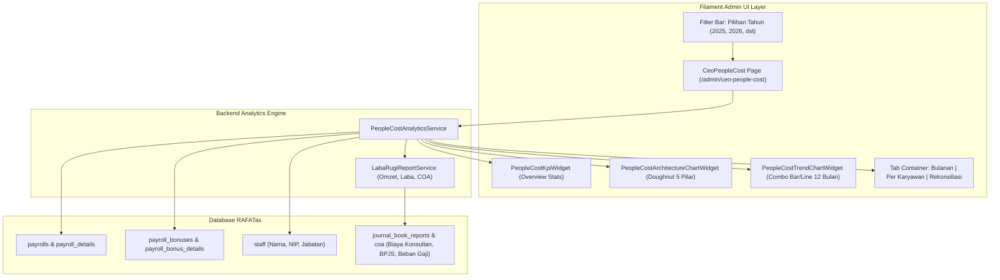
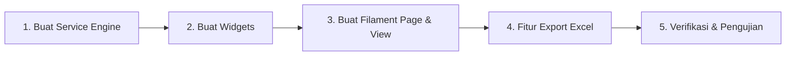

# Implementation Plan: CEO People Cost & Analisis SDM (Opsi B)

> [!NOTE]
> Dokumen ini memuat arsitektur teknis, desain antarmuka, pemetaan data database, formula komputasi, dan tahapan implementasi untuk modul **CEO People Cost & Analisis Profitabilitas SDM** berbasis integrasi otomatis modul **Payroll** dan **Laba Rugi** di RAFATax.

---

## 1. Latar Belakang & Tujuan

Berdasarkan dokumen analitis _CEO PEOPLE COST RAFATax_, manajemen membutuhkan visibilitas mendalam mengenai hubungan antara **Beban Ketenagakerjaan (People Cost)** dengan **Omzet (Pendapatan)** dan **Profitabilitas Bersih (Net Profit Margin)**.

Sistem saat ini telah memiliki modul data operasional:

1. `Payroll` & `PayrollDetail`: Menyimpan komponen gaji pokok, tunjangan jabatan/kompetensi, lembur, transport visit solo/luar, potongan BPJS/izin/sakit, dan absensi.
2. `PayrollBonus` & `PayrollBonusDetail`: Menyimpan validasi bonus kasus/event tim.
3. `LabaRugiReportService`: Menghitung Omzet bulanan, Total Beban operasional, dan Laba Rugi Bersih.

### Tujuan Utama Fitur:

- **Normalisasi Arsitektur People Cost:** Mengelompokkan komponen SDM ke dalam 5 pilar manajemen modern:
    1. _Fixed Compensation_ (Gaji Pokok & Tunjangan Tetap)
    2. _Variable / Performance_ (Bonus Kasus/Event & Lembur)
    3. _Operational Variable_ (Transport Solo/Luar & Tunjangan Operasional)
    4. _Employee Benefit & Recognition_ (BPJS Kesehatan, BPJS TK, Apresiasi/Reward)
    5. _Professional / Partner Compensation_ (Fee Konsultan / Ahli CEO & Future Partner)
- **Monitoring Rasio Efisiensi SDM:** Menghitung rasio People Cost terhadap Omzet (Benchmark industri: ~30% – 45%) secara otomatis per bulan dan per tahun.
- **Transparansi Performa Karyawan:** Menampilkan ringkasan tahunan per staf beserta rekapitulasi absensi/cuti.
- **Kemudahan Pelaporan Direksi:** Visualisasi grafik eksekutif dan fitur ekspor Excel satu klik.

---

## 2. Arsitektur Teknis Sistem

---

## 3. Pemetaan Data Database ke 5 Pilar People Cost (Opsi B)

Perhitungan ditarik secara dinamis dari tabel-tabel terkait:

| Pilar Manajemen               | Komponen Analitis           | Sumber Data Database                                     | Formula / Aturan Kalkulasi                                      |
| :---------------------------- | :-------------------------- | :------------------------------------------------------- | :-------------------------------------------------------------- |
| **1. Fixed Compensation**     | Gaji Pokok                  | `payroll_details.salary`                                 | `SUM(salary)`                                                   |
|                               | Tunjangan Jabatan           | `payroll_details.bonus_position`                         | `SUM(bonus_position)`                                           |
|                               | Tunjangan Kompetensi        | `payroll_details.bonus_competency`                       | `SUM(bonus_competency)`                                         |
| **2. Variable / Performance** | Bonus Kasus / Event         | `payroll_bonus_details.amount`                           | `SUM(amount)` dari payroll bonus yang disetujui                 |
|                               | Uang Lembur                 | `payroll_details`                                        | `SUM(overtime_count * overtime_multiplier)`                     |
| **3. Operational Variable**   | Transport Solo              | `payroll_details.visit_solo_count`                       | `SUM(visit_solo_count * 10000)`                                 |
|                               | Transport Luar Solo         | `payroll_details.visit_luar_solo_count`                  | `SUM(visit_luar_solo_count * 15000)`                            |
|                               | Tunjangan Lain / Pulsa      | `payroll_details`                                        | `SUM(bonus_lain + bonus_transport + bonus_pulsa)`               |
| **4. Benefit & Recognition**  | BPJS Kesehatan              | `payroll_details.cut_bpjs_kesehatan` / COA BPJS          | `SUM(cut_bpjs_kesehatan)` + Beban Perusahaan di Laba Rugi       |
|                               | BPJS Ketenagakerjaan        | `payroll_details.cut_bpjs_ketenagakerjaan` / COA BPJS    | `SUM(cut_bpjs_ketenagakerjaan)` + Beban Perusahaan di Laba Rugi |
|                               | Reward / Apresiasi Khusus   | Jurnal Pembukuan COA terkait (misal: Antam/Umroh/Magang) | Ditarik berdasarkan filter COA Beban Terkait                    |
| **5. Professional / Partner** | Fee Konsultan / CEO Partner | COA `Biaya Konsultan` dari `LabaRugiReportService`       | Total mutasi debit akun Konsultan/Tenaga Ahli                   |
| **Konteks Finansial**         | Omzet (Pendapatan)          | `LabaRugiReportService::getMonthlyReport()`              | `totalPendapatan` (Group 40 & 60)                               |
|                               | Laba Bersih                 | `LabaRugiReportService::getMonthlyReport()`              | `labaRugiBersih`                                                |
|                               | Rasio People Cost           | Kalkulasi Engine                                         | `(Total People Cost / Omzet) * 100%`                            |

---

## 4. Rincian Antarmuka & Fitur Halaman

Halaman akan dibuat di namespace [`App\Filament\Pages\CeoPeopleCost`](file:///e:/laragon/www/rafatax/app/Filament/Pages/CeoPeopleCost.php):

### A. Header & Filter Bar

- Dropdown Tahun Aktif (default: tahun berjalan, opsi: 2025, 2026, 2027...).
- Tombol **Export Excel Eksekutif** format laporan resmi.

### B. Baris 1: Executive KPI Widgets (`PeopleCostKpiWidget`)

1. **Total People Cost & % Omzet:** Nilai total kumulatif 5 pilar dan persentasenya terhadap omzet tahunan.
2. **Fixed vs Variable Ratio:** Rasio persentase beban tetap (Fixed) vs performa/operasional variabel.
3. **Net Profit Margin (NPM):** Margin laba bersih aktual dari Laba Rugi.
4. **Total THP Payroll & Karyawan:** Nilai bersih gaji yang ditransfer ke rekening staf dan jumlah staf aktif.

### C. Baris 2: Visualisasi Interaktif (Dua Widget Sejajar)

1. **Doughnut Chart (Arsitektur People Cost):** Proporsi 5 pilar dalam bentuk visual donat interaktif.
2. **Combo Chart (Tren 12 Bulan Omzet vs People Cost):** Batang Omzet, Batang Beban SDM, dan Garis Net Profit Margin dari Januari hingga Desember.

### D. Baris 3: Tab Navigasi Data Terperinci

- **Tab 1: Rekap Bulanan (Jan – Des)**
  Matriks 12 bulan x komponen (Gaji Pokok, Tunjab, Tunkomp, Lembur, Transport, Bonus, Bruto Analitis, Potongan, THP).
- **Tab 2: Analisis per Karyawan**
  Tabel seluruh staf: Nama, Bulan Aktif, Gaji Pokok, Tunjangan, Lembur, Bonus, Potongan, THP, serta statistik absensi (Sakit, Tengah Hari, Izin, Lembur Jam, Cuti).
- **Tab 3: Rekonsiliasi & Audit Trail**
  Tabel catatan audit manajemen (reklasifikasi transaksi dari COA Laba Rugi: Umroh, Antam, Emas Loyalitas, Honor Magang, Biaya Konsultan CEO).

---

## 5. File yang Akan Dibuat & Dimodifikasi

| No  | Tipe Komponen                 | Path File                                                    | Keterangan                                                       |
| :-- | :---------------------------- | :----------------------------------------------------------- | :--------------------------------------------------------------- |
| 1   | **Service Engine**            | `app/Services/PeopleCostAnalyticsService.php`                | Mesin agregasi otomatis dari Payroll, Bonus, Staff, dan LabaRugi |
| 2   | **Filament Page**             | `app/Filament/Pages/CeoPeopleCost.php`                       | Controller halaman analitis eksekutif                            |
| 3   | **Blade View Page**           | `resources/views/filament/pages/ceo-people-cost.blade.php`   | View Filament dengan tab container dan tabel matriks             |
| 4   | **KPI Overview Widget**       | `app/Filament/Widgets/PeopleCostKpiWidget.php`               | 4 kartu KPI utama (Omzet, People Cost, Rasio, THP)               |
| 5   | **Architecture Chart Widget** | `app/Filament/Widgets/PeopleCostArchitectureChartWidget.php` | Doughnut chart 5 pilar People Cost                               |
| 6   | **Trend Chart Widget**        | `app/Filament/Widgets/PeopleCostTrendChartWidget.php`        | Bar/Line chart 12 bulan Omzet vs People Cost                     |
| 7   | **Admin Panel Provider**      | `app/Providers/Filament/AdminPanelProvider.php`              | Mendaftarkan widget agar Livewire mengenali komponen             |

---

## 6. Tahapan Eksekusi (Implementation Steps)

### Tahap 1: Pembuatan `PeopleCostAnalyticsService`

- Mengimplementasikan metode:
    - `getYearlySummary(int $year)`: Menghitung total 5 pilar, Omzet, Laba Bersih, Rasio %, dan KPI eksekutif.
    - `getMonthlyBreakdown(int $year)`: Menyusun matriks 12 bulan (Jan–Des) per komponen.
    - `getEmployeeBreakdown(int $year)`: Mengagregasi data per staf dari `payroll_details` dan `staff`.
    - `getAuditReconciliation(int $year)`: Memetakan transaksi reklasifikasi manajemen dari GL/Laba Rugi.

### Tahap 2: Pembuatan Widget Filament

- Membuat `PeopleCostKpiWidget` turunan `StatsOverviewWidget`.
- Membuat `PeopleCostArchitectureChartWidget` turunan `ChartWidget` (tipe `doughnut`).
- Membuat `PeopleCostTrendChartWidget` turunan `ChartWidget` (tipe `bar` + `line`).
- Mendaftarkan ketiga widget di `AdminPanelProvider.php`.

### Tahap 3: Pembuatan Halaman & Blade View

- Membuat kelas `CeoPeopleCost` dengan navigasi group `Bagian Keuangan`, icon `heroicon-o-user-group`, dan pembatasan role `admin`.
- Menyusun layout Blade dengan tab interaktif untuk tabel bulanan, tabel per karyawan, dan tabel audit trail.

### Tahap 4: Fitur Ekspor Excel Eksekutif

- Mengintegrasikan `PhpOffice\PhpSpreadsheet` untuk mengunduh rekap berformat rapi dengan multi-sheet (Sheet 1: Ringkasan Eksekutif & Bulanan, Sheet 2: Detail per Karyawan).

### Tahap 5: Verifikasi & Optimasi

- Uji coba kalkulasi data tahun 2025 dan 2026.
- Verifikasi keamanan akses (hanya admin yang dapat membuka).
- Pembersihan cache view (`php artisan optimize:clear`).

---

## 7. Keputusan Desain & Pertimbangan

> [!TIP]
> **Penanganan Data Transisi 2025 vs 2026:**
> Karena sebagian payroll 2025 sebelumnya diproses via spreadsheet manual, service dirancang dengan _fallback check_: jika bulan tertentu di database belum memiliki record payroll, service dapat memanfaatkan data dasar tervalidasi yang ada atau menampilkan indikator audit yang transparan tanpa merusak integritas data 2026 yang sudah full digital.
